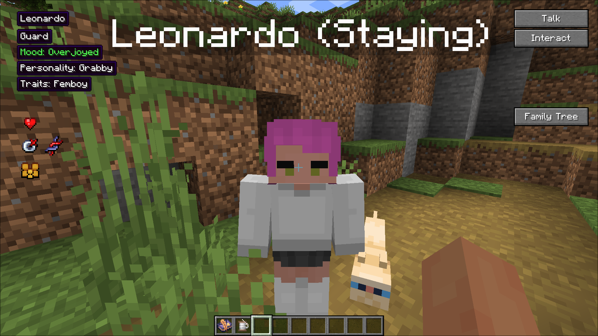

This Addon add Femboy trait to MCA Reborn.

Key detail:
* Femboy can spawn naturally with very rare chance. You can see them with female clothes and hair.
* Femboy will speak in female voice. You can also remove it in config file of this mod.
* Femboy can be attracted to any gender, meaning you can crack your lovelei femboi best friend even if you are a guy.

Dependencies:
* Minecraft 1.21.1 (NeoForge/Fabric)
* MCA Reborn >=7.7.33

Development:
* If you run Fabric client on Intellj Idea, Fabric won't automatically add MCA Reborn into your mods folder. You have to add the mod by yourself.
* You can see in the source code, there is a custom item called "Twenty Dollars", which is inspired by the meme "twenty dollars is twenty dollars". You can gift it to a male villager and turn him into femboy. But right now, it doesn't have any recipe, isn't available in creative tab and doesn't have a unique texture because I cannot find a reasonable way to add it. Any man is willing to dress up kawaii for 20 bucks is kinda unnatural. So I'll just leave it in the source code until someone figures out a way to make this work without sacrificing their dignity.
